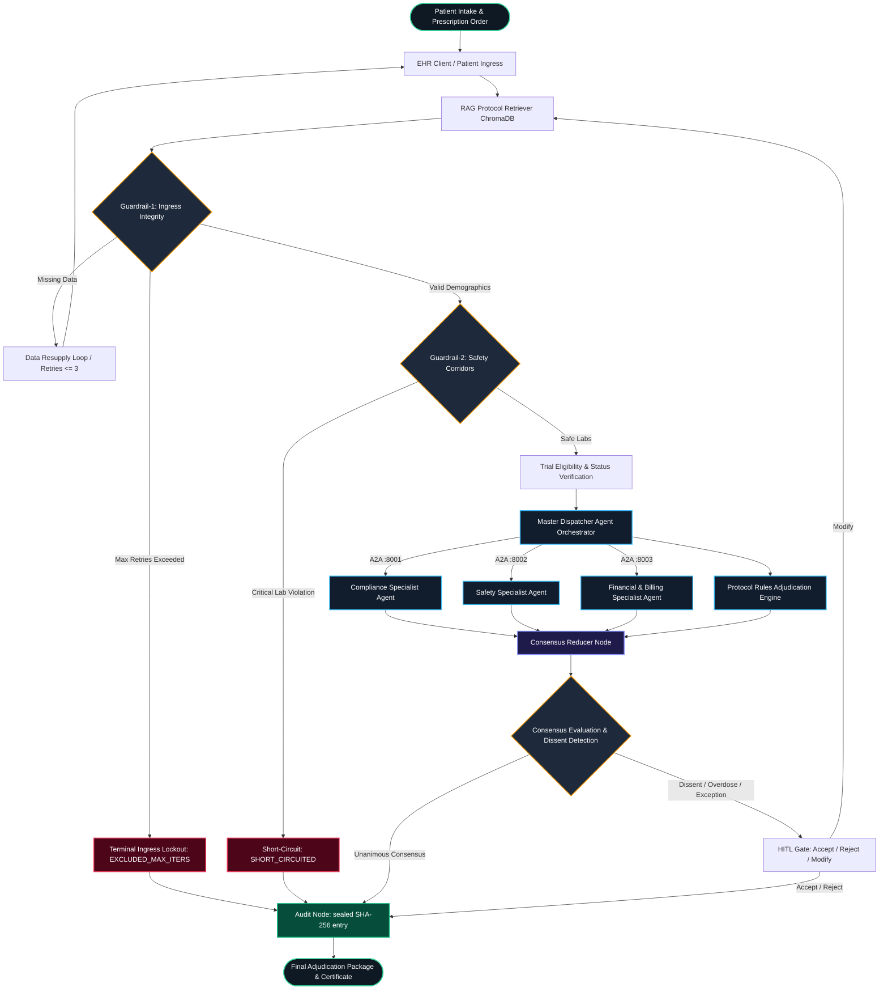

<div align="center">

# TrialGuard
### Agentic Point-of-Care Validation for Clinical Trials

[](https://techquest-roan.vercel.app)
[](https://github.com/a2aproject/A2A)
[](https://github.com/langchain-ai/langgraph)
[](https://modelcontextprotocol.io)
[](https://nextjs.org)
[](https://reactflow.dev)
[](#audit-trail--regulatory-alignment)
[](https://python.org)

<p align="center">
  When a researcher proposes a mid-trial dose change, TrialGuard checks protocol compliance, patient safety, and financial impact, then records what the system advised and what the human decided.
</p>

<p align="center">
  Live app: <a href="https://techquest-roan.vercel.app">https://techquest-roan.vercel.app</a>
</p>

</div>

> Research prototype. TrialGuard is a proof of concept built and tested on open-source protocol documents and synthetic patient data. It is not a medical device, has not been clinically validated, and must not be used to make real treatment decisions.

---

## Table of Contents

1. [The Problem](#the-problem)
2. [What TrialGuard Does](#what-trialguard-does)
3. [A Simple Example](#a-simple-example)
4. [Why an Agentic Approach](#why-an-agentic-approach)
5. [Architecture](#architecture)
6. [Key Design Decisions](#key-design-decisions)
7. [Core Features](#core-features)
8. [Tech Stack](#tech-stack)
9. [Existing Alternatives](#existing-alternatives)
10. [User Research](#user-research)
11. [Implementation Status](#implementation-status)
12. [Installation & Setup](#installation--setup)
13. [Running TrialGuard](#running-trialguard)
14. [Run the tests](#run-the-tests)
15. [Evaluator Walkthrough](#evaluator-walkthrough)
16. [Test Patient Matrix](#test-patient-matrix)
17. [Audit Trail & Regulatory Alignment](#audit-trail--regulatory-alignment)
18. [Database](#database)
19. [Limitations & Future Work](#limitations--future-work)
20. [Troubleshooting](#troubleshooting)
21. [Repository history](#repository-history)
22. [Team and my contribution](#team-and-my-contribution)
23. [References](#references)
24. [Acknowledgements](#acknowledgements)

---

## The Problem

When a researcher, nurse, or doctor wants to change a patient's dose during an ongoing trial, they need answers to three questions:

1. Protocol: is the new dose still within what the protocol allows?
2. Safety: is it safe for *this* patient?
3. Cost: how does it affect the trial's budget?

Today these answers usually come from memory, or from different people and systems, one piece at a time. Afterward there is no record of whether advice was sought, what was said, or whether it was followed.

The evidence suggests this gap is real:

| Finding | Source |
|:---|:---|
| Clinicians override medication alerts roughly 46–96% of the time. One tertiary-hospital study measured 92.2%, and 13% of those overrides had no audited reason | [1], [2] |
| A typical Phase III trial has around 119 protocol deviations, affecting about a third of patients | [3] |
| Monitoring for such problems can consume 15–30% of a trial's total budget | [4] |
| The industry-standard risk tool (TransCelerate RACT) is completed once, usually in a spreadsheet, before the trial starts and is not revisited as decisions happen | [5] |
| A 2026 shared task showed risky dosing patterns are measurable at scale, but it remains a research benchmark rather than a deployed tool | [6] |

Our thesis: agent apps can move protocol, safety, and financial checks from something *discovered after a decision is made* to something *checked at the moment of decision*, and can turn every human override of that check into a recorded, accountable event instead of an invisible one.

---

## What TrialGuard Does

TrialGuard steps in at one moment, for one proposed action at a time:

1. A researcher submits a proposed dose change for a patient in a trial.
2. The system pulls the patient's record (FHIR-shaped synthetic data) and the relevant protocol evidence, keyed by Trial ID.
3. Deterministic guardrails check data integrity and hard safety limits.
4. Three independent specialist agents (Compliance, Safety, Financial) are called in parallel over the A2A protocol.
5. A reducer merges their verdicts with a deterministic rule and flags dissent.
6. A human-in-the-loop step lets the researcher Accept, Reject, or Modify.
7. The decision and the agent results are saved as a report. Each report carries a SHA-256 hash that links it to the previous report for the same patient.

Who uses it

- Researchers and investigators get advice *before* they act.
- The saved reports record what was recommended and what the human decided. A view for trial leadership that aggregates this across researchers is **not built yet** (see [Limitations](#limitations--future-work)).

---

## A Simple Example

A trial protocol caps Apixaban at 5 mg twice daily. A researcher proposes 40 mg twice daily for a patient.

- The Compliance Agent compares the proposed dose with the protocol clause and returns `NON_COMPLIANT`: the dose exceeds the 5 mg cap.
- The Safety Agent reads this patient's labs and history and flags patient-specific risk.
- The Financial Agent checks the proposed order against coverage rules and reports coverage and cost exposure.

The reducer combines these into one recommendation: `NOT_JUSTIFIED`, with a suggested compliant alternative. The researcher can accept the suggestion, reject it and keep the original order, or modify the plan to something in between. Whatever they choose is saved, so anyone reviewing the trial later can see what was recommended and what actually happened.

---

## Why an Agentic Approach

Three reasons drove the choice of agents over a simple rule checker:

1. Protocols are unstructured. Eligibility criteria, safety limits, and dosing rules are written in natural language. Converting them into rigid if-then rules is fragile and means rewriting code whenever a protocol changes. TrialGuard instead treats the protocol as a knowledge source: it is parsed, chunked, embedded, and stored in a vector database (`services/rag_service`). At query time the most relevant clauses are retrieved by semantic similarity and passed to the LLM, which reasons over them alongside the patient's data. (See [Implementation Status](#implementation-status) for where this is and is not wired into the running app.)

2. The decision needs three kinds of judgment at once. In practice these questions go to three different people: *is it safe, does it follow the rules, what does it cost?* Splitting the work across three focused agents running in parallel mirrors how a hospital actually does it, in seconds instead of days.

3. A2A keeps the system modular. Specialist agents are independent services that talk to the master agent over a standard protocol, so they can be built, tested, and swapped without disrupting the pipeline. The architecture also keeps the human in charge: the agents report trade-offs, and the researcher makes the final call.

---

## Architecture

```
       [ EMR / FHIR Ingress ]
                 │
   ┌─────────────▼─────────────┐
   │ Guardrail-1: Schema/Demo  │ ──(Missing Data)──> [ Resupply Loop / Lockout ]
   └─────────────┬─────────────┘
                 │ (Passed)
   ┌─────────────▼─────────────┐
   │ Guardrail-2: Safety Floor │ ──(Life-Threatening)─> [ SHORT-CIRCUIT ]
   └─────────────┬─────────────┘
                 │ (Passed)
   ┌─────────────▼─────────────┐
   │ Master Dispatcher Fan-Out │
   └──────┬───────────┬────────┘
          │           │
 ┌────────▼─────┐ ┌───▼──────────┐ ┌─────────────▼┐
 │  Compliance  │ │    Safety    │ │  Financial   │  <== A2A microservices
 │  Specialist  │ │  Specialist  │ │  Specialist  │      (Ports 8001-8003)
 └────────┬─────┘ └───┬──────────┘ └─────────────┬┘
          │           │                          │
          └───────────┼──────────────────────────┘
                      ▼
            [ Consensus Reducer ]
                      │
                      ▼
   ┌─────────────────────────────────────┐
   │ HITL Gate: Accept / Reject / Modify │
   │  - Free-Text Doctor Note Extraction │
   │  - Typo Correction (synonym list)   │
   │  - 1-Click Protocol Remediation     │
   │  - Write-back to local fixtures     │
   └──────────────────┬──────────────────┘
                      │
                      ▼
       [ Saved report + SHA-256 hash chain ]
```

This is the design view. The two code paths below implement it differently.

### Two execution paths

**Gateway path (what `start_all.py` and the web app run).** The Next.js app talks to the FastAPI gateway in `apps/gateway`. `services/client_agent.py` extracts the proposed action, calls the three specialists over A2A in parallel (falling back to in-process calls if a specialist service is down), applies the guardrails, runs the reducer, and holds the result for the HITL step. On Accept or Reject, `services/supabase_reports.py` saves the report to local JSON and, if configured, Supabase.

In this path:
- The protocol evidence passed to the Compliance agent is a small fixed set of clauses per trial (`_simulated_rag_output` in `apps/gateway/routers/orchestrator.py`), not a live vector search.
- The guardrails are evaluated after the specialists are called, and override their results when they trip.
- Some demo patients have scripted outcomes keyed by patient ID (`client_agent.py`: P037, P048, P049, P050, and the passing cases P036 and P051–P054). Specialist confidence values and the arbitration confidence are fixed numbers, not computed.

**LangGraph reference path (`apps/orchestrator`).** A LangGraph state machine (`graph.py`) with the guardrails running before the specialists are called, an `interrupt()`-based HITL node (`hitl.py`), a Modify loop back to retrieval, and a Postgres-or-memory checkpointer (`checkpointer.py`). Protocol retrieval uses Chroma when a vector index has been built, and falls back to a rule evaluator otherwise. It runs from `python -m scripts.batch_audit` and the standalone `apps/orchestrator/server.py`. It is **not** wired into the web app. The generated graph is in [`docs/orchestrator_graph.mmd`](docs/orchestrator_graph.mmd) and [`docs/orchestrator_graph.png`](docs/orchestrator_graph.png).

### LangGraph flow (design view)



### Monorepo structure

```
TrialGuard/
├── apps/
│   ├── web/                     # Next.js 16 Command Center (React 19, @xyflow/react, Tailwind v4)
│   ├── gateway/                 # FastAPI gateway: ingress, guardrails, reducer, report store (:8000)
│   ├── agent-compliance/        # Protocol Compliance Agent service (:8001, A2A)
│   ├── agent-safety/            # Patient Safety Agent service (:8002, A2A)
│   ├── agent-financial/         # Financial & Coverage Agent service (:8003, A2A)
│   ├── agent_master/            # A2A master client used by the LangGraph path
│   └── orchestrator/            # LangGraph state machine, nodes, checkpointer, PDF report generator
├── packages/
│   ├── mcp-ehr/                 # FastMCP FHIR R4 server, patient fixtures, FHIR client
│   ├── mcp-audit/               # SHA-256 hash chain for audit records
│   ├── mcp-rag/                 # Empty package (RAG is a FastAPI service in services/rag_service)
│   └── shared-schemas/          # Pydantic models and rule definitions (Python only)
├── services/
│   └── rag_service/             # FastAPI RAG/rule service: ingestion, Chroma store, embeddings, tests
├── scripts/                     # seed_comprehensive_patients.py, batch_audit.py, check_all_confidence.py, visualize_graph.py
├── docs/                        # CHANGES.md, generated LangGraph diagram
├── supabase/migrations/         # SQL for the adjudication_reports column
├── User Research/               # User_Research.pdf
├── Market Research/             # Market_Research_final.pdf
├── start_all.py                 # Starts the web app, gateway and three agent services
├── pyproject.toml               # uv workspace and pytest config
├── package.json                 # Turborepo / pnpm workspace
└── .env.example                 # Environment variable template
```

---

## Key Design Decisions

### Grounding each specialist agent

Each agent is constrained to a specific, checkable source rather than an open-ended prompt.

- Protocol Compliance is given protocol clauses for the trial (by Trial ID) and the proposed action. It checks whether a proposed dose escalation or frequency change aligns with the phase schedule and dose-modification rules. In the running app the clauses are the fixed set described above; the retrieval pipeline that would supply them lives in `services/rag_service`.
- Patient Safety is given dedicated structured fields (age, weight, kidney and liver lab results, and so on) so it can flag risks specific to *this* patient instead of giving generic advice. It also evaluates drug-drug interactions and toxicity corridors.
- Financial & Billing does not let the LLM decide cost figures. Exposure amounts come from a hard-coded per-drug table in the agent code, and coverage status is overridden by a dose check when the dose is outside the protocol. The LLM only contributes the coverage explanation. There is no external cost-sheet file or billing database; the billing policies named in the output are text in the code.

### Context isolation

Each specialist only sees what it needs. The Safety agent receives structured EHR data and the proposed action (no protocol text); the Compliance agent receives protocol rules and the action (no patient history). The A2A adapter rejects a compliance payload that contains patient data and a safety payload that contains protocol chunks (`apps/gateway/a2a_server.py`), and the Financial agent's payload has patient identifiers stripped before it is sent.

- Independent opinions. In a single monolithic prompt, an agent that sees both datasets can be biased by one against the other, for example inventing safety concerns simply because a protocol is strict. Isolation keeps each assessment independent before consensus.
- Parallel execution. Because the agents do not depend on each other, the three are called concurrently. Latency is bounded by the *slowest* agent, not the sum of all three.

### Deterministic before probabilistic

Hard clinical limits are checked in code, not by the LLM. In the LangGraph path they run before any specialist is called. In the gateway path they run after the specialists respond and override them, so the LLM never decides a catastrophic case, but tokens are still spent on it.

### The human stays in charge

The system advises; the researcher decides. Modify exists because clinical decisions are rarely binary.

---

## Core Features

#### 1. A2A Specialist Consensus
Instead of a single monolithic prompt, clinical reasoning is split across independent services communicating over the Agent-to-Agent (A2A) protocol via HTTP / JSON-RPC 2.0 (method `SendMessage`, served at `/` and `/rpc` on each agent):
* Protocol Compliance Agent (`:8001`): dosing limits and protocol rules.
* Safety Specialist Agent (`:8002`): drug-drug interactions, toxicity corridors, organ-function limits.
* Financial & Billing Agent (`:8003`): sponsor coverage and patient out-of-pocket exposure.

Each agent publishes an agent card at `/.well-known/agent-card.json`. If an agent service is unreachable, the gateway falls back to calling the same logic in-process.

#### 2. Two-Tier Ingress Guardrails
* Guardrail-1 (demographic integrity and retry budget): checks patient ID, age and biological sex. The retry budget is 3 attempts (`max_iters`); when it is exhausted the patient is locked out (`EXCLUDED_MAX_ITERS`). In the gateway path the resupply is entered by a clinician in the UI; in the LangGraph path `data_resupply` re-queries the EHR client.
* Guardrail-2 (catastrophic safety corridors): in the gateway path, fails on eGFR < 15 mL/min/1.73m², ANC < 500/µL, total bilirubin > 4.0 mg/dL, or ALT/AST > 200 U/L, and short-circuits the verdict to `NOT_JUSTIFIED`. The LangGraph path applies the baseline and per-trial rules in `packages/shared-schemas/shared_schemas/rules.py` instead.

#### 3. RAG Protocol Knowledge Engine
`services/rag_service` implements ingestion, chunking, embeddings (sentence-transformers), a Chroma vector store and a rule engine for four demo protocols (antithrombotic, oncology, SGLT2i renal, NAFLD/MASH). The vector index is not committed (`vector_db/` is gitignored), and the gateway path does not query it (see [Two execution paths](#two-execution-paths)).

#### 4. Consensus Reducer
Gathers the three specialist results and applies a deterministic rule: any `NON_COMPLIANT` or `UNSAFE` result gives `NOT_JUSTIFIED`; all three clear gives `JUSTIFIED`; anything else gives `NEEDS_REVIEW`. An LLM writes the short summary text only. The gateway also lists which agents disagreed (`agent_discrepancies`).

#### 5. HITL Gate and write-back
When a protocol deviation or overdose occurs:
* Free-text note extraction: an LLM parses the physician's note into a structured order. If the LLM is unreachable (1.2 s limit), a local rule-based extractor is used.
* Typo normalization: misspelled drug names are corrected from a built-in synonym list (e.g. `"apixiban"` to `Apixaban`).
* Conversational filtering: vague or non-clinical notes trigger a `Clinical Warning: Inappropriate or Ambiguous Doctor Note` banner and block submission until resolved.
* 1-click protocol remediation: one click normalizes a non-compliant dose to the protocol-compliant ceiling.
* Write-back: validated updates are written to the local patient JSON fixtures and, when Supabase is configured, to the `patients.prescribed_action` column. Failures to write are not surfaced to the user. There is no FHIR server write-back.

#### 6. Hash-Chained Report Store
Each saved decision report is sealed with a SHA-256 hash that depends on its contents and on the previous report for the same patient. `GET /api/reports/{patient_id}/verify` recomputes the chain and reports the first broken link. See [Audit Trail & Regulatory Alignment](#audit-trail--regulatory-alignment).

#### 7. Command Center UI with Live ReactFlow Telemetry
Built on Next.js 16, React 19, and `@xyflow/react` v12, with Server-Sent Events (SSE) streaming so the multi-agent execution graph updates as the agents finish.

---

## Tech Stack

| Layer | Technology | Role |
|:---|:---|:---|
| Backend | FastAPI | Gateway the dashboard talks to; also hosts the in-process A2A adapter |
| Orchestration | LangGraph | Reference state machine: guardrails, HITL interrupt, Modify loop (not wired to the web app) |
| Agent communication | A2A protocol | The gateway calls the three specialist services over JSON-RPC 2.0 |
| Tool access | FastMCP | `packages/mcp-ehr` exposes `get_patient`, `search_patients`, `find_nearest_patients` as an MCP server. The pipeline imports the same functions directly |
| Retrieval | Chroma + sentence-transformers | RAG service; index must be built locally |
| Persistence | Supabase *(optional)* | `patients` table, report storage, optional Postgres for the LangGraph checkpointer. Falls back to local JSON / memory |
| Frontend | Next.js 16, React 19, ReactFlow | Researcher-facing dashboard and live graph |
| LLM | Any OpenAI-compatible API | `KADO_API_KEY` or `OPENAI_API_KEY`; Groq optionally for FHIR harmonization. No provider fallback chain |

---

## Existing Alternatives

We found no existing tool that combines protocol-specific compliance, patient-specific safety, and cost impact into a single recommendation with an audited override trail. This is based on our own search, not a systematic review.

| Tool | Domains | Frequency | Audit trail |
|:---|:---|:---|:---|
| Hospital CDS alerts | Safety only | Point-of-care | Dropdown reason code |
| TransCelerate RACT [5] | Protocol complexity & operational risk | Once, at design | None |
| CluePoints [7] | Data / safety statistics | Periodic / post-hoc | Batch (site-level) |
| TrialGuard | Safety, protocol, financial | Point-of-care, per action | Per-decision report with hash chain |

- Hospital CDS alerts focus on general formulary interactions, not trial-specific investigational protocols, and override tracking is typically a dismissive dropdown without a verifiable rationale.
- TransCelerate RACT evaluates risk across several categories but is a static checklist at protocol design, not an active system during execution.
- CluePoints performs centralized statistical surveillance across sites, retrospectively. It does not parse protocol semantics or evaluate individual point-of-care actions.

Market sizing and the competitive comparison are in [Market Research](Market%20Research/Market_Research_final.pdf).

---

## User Research

We interviewed seven practitioners across clinical research, pharmacovigilance, and medicine, as written question-and-answer exchanges. Their feedback shaped the Modify option and the short rationale display. The details are in [User Research](User%20Research/User_Research.pdf), and the market analysis is in [Market Research](Market%20Research/Market_Research_final.pdf). Names are in [Acknowledgements](#acknowledgements).

---

## Implementation Status

Every claim in this project is labelled as implemented, simulated, or assumed.

| Type | Description |
|:---|:---|
| Implemented | FastAPI gateway; three A2A specialist services with JSON-RPC 2.0 `SendMessage`; context isolation checks; Guardrail-1 and Guardrail-2; deterministic reducer; Accept / Reject / Modify flow; hash-chained report store with a verify endpoint; ReactFlow dashboard with SSE; FastMCP EHR server; LangGraph reference workflow with a Postgres-or-memory checkpointer |
| Simulated | Open-source protocol documents; synthetic FHIR-shaped patient data (54 profiles); the protocol clauses the gateway path passes to the Compliance agent; scripted outcomes for several demo patients; the cost table behind the Financial agent |
| Built but not used by the running app | Chroma retrieval pipeline (needs a locally built index); LangGraph workflow and Postgres checkpointer (run via `scripts/batch_audit.py`; only the checkpointer's table setup has been run against a local Postgres, not a full pause-and-resume) |
| Not implemented | RAG as an MCP server; leadership view of researcher accept/override behavior; a lockout registry for barred subjects (lockout is per-session UI state); FHIR server write-back; Gemini and multi-provider LLM fallback |
| Assumed | That accumulated Accept / Reject / Modify records would give trial leadership a materially different view of researcher behavior than they have today |

The pipeline is designed to run on an organization's own protocol documents and a real FHIR dataset without architectural changes. The substitutions above reflect what data was available to us, not a limit of the pipeline.

Supabase: the web app reads the `patients` table (`apps/web/app/actions.ts`), and `scripts/seed_comprehensive_patients.py` can upsert synthetic patients into it. The gateway reads patients from local JSON, not Supabase. Reports are written locally first, then to `patients.clinical_data.adjudication_reports`, then to the `adjudication_reports` jsonb column added by [`supabase/migrations`](supabase/migrations/20260916_add_adjudication_reports.sql). The `patients` definition is in the first migration; see [Database](#database).

---

## Installation & Setup

### Prerequisites

* OS: macOS (Apple Silicon or Intel), Linux (Ubuntu 20.04+ / Debian 11+), or Windows 11 with WSL2
* Memory / disk: 8 GB RAM minimum, 3 GB free disk space (the Python environment includes `sentence-transformers` and its dependencies)
* Python: 3.11 or higher (`python3 --version`)
* Node.js: 20.x LTS or later (`node --version`)
* `uv` (Python workspace manager):
  ```bash
  curl -LsSf https://astral.sh/uv/install.sh | sh
  ```
* `pnpm`:
  ```bash
  npm install -g pnpm@12.3.4
  ```
* An API key for an OpenAI-compatible LLM endpoint. Without one the app still runs: the safety and financial agents use local rules, but the compliance agent returns `UNKNOWN` and the gateway's rule checks decide the verdict.
* *(Optional)* Supabase URL and key for cloud persistence. If omitted, TrialGuard falls back to in-memory and local-disk storage.

### Step 1: Clone

```bash
git clone https://github.com/Pranjal-Kukreja/TrialGuard.git
cd TrialGuard
```

### Step 2: Python dependencies

```bash
uv sync
```

<details>
<summary>Alternative: plain pip setup</summary>

```bash
python3 -m venv .venv
source .venv/bin/activate  # On Windows: .venv\Scripts\activate
pip install -r requirements.txt
pip install -e packages/shared-schemas
pip install -e packages/mcp-audit
pip install -e packages/mcp-ehr
pip install -e apps/gateway
pip install -e apps/orchestrator
pip install -e apps/agent-compliance
pip install -e apps/agent-safety
pip install -e apps/agent-financial
pip install -e apps/agent_master
```
This path is not tested; `uv sync` is the supported route.
</details>

### Step 3: Frontend dependencies

```bash
pnpm install
```

### Step 4: Configure environment

```bash
cp .env.example .env
```

Edit `.env`. The variables the code reads are listed with comments in [`.env.example`](.env.example). At minimum set `KADO_API_KEY` or `OPENAI_API_KEY` (and `KADO_BASE_URL` / `KADO_MODEL` if you are not using the hackathon gateway). `A2A_*_URL` values are base URLs such as `http://127.0.0.1:8001`; the gateway appends `/rpc`.

> Never commit your `.env` file or API keys.

### Step 5: Seed synthetic patients *(optional)*

The patient fixtures (`packages/mcp-ehr/src/mcp_ehr/patients_expanded.json`) are already committed, so this step is only needed to regenerate them.

```bash
uv run python scripts/seed_comprehensive_patients.py
```
It adds the 17 scenario patients P038–P054 to the local fixture files and, if Supabase credentials are set, upserts them into the `patients` table.

---

## Running TrialGuard

### Method 1: One command (recommended)

```bash
uv run python start_all.py
```

This starts five services with color-coded, multiplexed logs:

```
==============================================================
  Starting TrialGuard Ecosystem (5 Services)
    - COMPLIANCE   -> http://localhost:8001
    - SAFETY       -> http://localhost:8002
    - FINANCIAL    -> http://localhost:8003
    - GATEWAY      -> http://localhost:8000
    - WEB          -> http://localhost:3000
==============================================================
```

Open http://localhost:3000. Press `Ctrl + C` to stop everything; the launcher traps `SIGINT`/`SIGTERM` and shuts down child processes.

### Method 2: Individual services (separate terminals)

```bash
uv run python apps/agent-compliance/server.py   # Terminal 1, :8001
uv run python apps/agent-safety/server.py       # Terminal 2, :8002
uv run python apps/agent-financial/server.py    # Terminal 3, :8003
uv run python apps/gateway/main.py              # Terminal 4, :8000
pnpm --filter @techquest/web dev                # Terminal 5, :3000
```

### Method 3: Headless batch run of the LangGraph workflow

```bash
uv run python -m scripts.batch_audit
```

Runs every ID in `seeded_patient_ids.json` (49 profiles) through the LangGraph reference workflow with the action "Standard Protocol Review". It takes a few minutes. Excerpt of real output, produced without an LLM key and without the agent services running (so the specialists used their fallbacks):

```
==========================================================================
  TRIALGUARD BATCH ADJUDICATION AUDIT: 49 PROFILES (NCT02415400)
==========================================================================

PID    | Name                   | Verdict    | Conf   | HITL   | Violations
------------------------------------------------------------------------
P038   | Ananya Deshmukh        | APPROVED   | 0.90   | False  | 0
P039   | Robert Chen            | APPROVED   | 0.90   | False  | 0
P041   | Vikram Malhotra        | REJECTED   | 0.40   | False  | 4
P042   | Zoe Washington         | REJECTED   | 0.40   | False  | 3
P043   | Suresh Patel           | REJECTED   | 0.40   | False  | 1
P045   | Tariq Mahmoud          | REJECTED   | 0.90   | True   | 1
P046   | Devraj Sengupta        | REJECTED   | 0.90   | True   | 2
...
```

In that run 44 profiles were `APPROVED` and 5 `REJECTED` (P041, P042, P043, P045, P046). The missing-demographics profiles P038 and P039 come out `APPROVED` on this path; the demographic lockout flow is exercised in the gateway path (see the walkthrough). `scripts/check_all_confidence.py` is a near-duplicate without error handling that prints the same table.

### Method 4: Visualize the LangGraph topology

```bash
uv run python -m scripts.visualize_graph
```
Prints an ASCII graph and writes `docs/orchestrator_graph.mmd` (Mermaid) and `docs/orchestrator_graph.png`. The PNG step uses a remote Mermaid renderer and needs internet access.

### Verification commands

```bash
# Web build validation (TypeScript + Next.js)
pnpm --filter @techquest/web build

# Gateway and agent health
curl -s http://localhost:8000/health                                    # {"status":"ok"}
curl -s http://localhost:8001/.well-known/agent-card.json               # also :8002, :8003

# Verify the hash chain of a patient's saved reports
curl -s http://localhost:8000/api/reports/P036/verify
```

---

## Run the tests

```bash
uv run pytest                                  # hash chain, report store, audit node (19 tests)
(cd services/rag_service && uv run pytest)     # RAG / rule engine suite (31 tests)
```

The first command covers the audit hash chain: a valid chain passes, editing any field of an earlier record fails verification at that record, record order matters, and the gateway's report store chains reports per patient and detects tampering. The agent contract tests need the agent services running and are not part of `pytest`:

```bash
uv run python start_all.py --agents            # in one terminal
uv run python apps/agent-safety/test_safety.py
uv run python apps/agent-financial/test_financial.py
uv run python apps/agent-compliance/test_compliance.py   # needs KADO_API_KEY or OPENAI_API_KEY
```

The compliance agent has no offline fallback, so its test returns `UNKNOWN` and fails without an LLM key.

---

## Evaluator Walkthrough

At http://localhost:3000 (gateway path), these flows show each design decision. The verdicts in flows 1–4 were checked by sending each patient through the gateway API during the cleanup. The browser interactions themselves (buttons, drawers, note extraction) were not re-tested in a browser then.

#### 1. Standard compliant patient
Select P051 (Lakshmi Ramanathan), order `Apixaban 5 mg oral twice daily` (CrCl 74 mL/min). The patient passes Guardrail-1 and Guardrail-2, the three agents run in parallel, and the result is `JUSTIFIED`. Accept it to save the report; the PDF certificate then shows the report's SHA-256 hash and a "chain verified" line.

#### 2. Guardrail-1 failure and lockout
Select P038 (missing biological sex) or P039 (missing age). Guardrail-1 fails and the verdict is `NOT_JUSTIFIED`. The UI asks the clinician to resupply the missing field; after 3 failed attempts the patient is locked out (`EXCLUDED_MAX_ITERS`) and the submit button is disabled.

#### 3. Guardrail-2 short-circuit
Select P041 (eGFR 11 < 15), P042 (total bilirubin 6.8 mg/dL > 4.0), or P043 (ANC 320/µL < 500). Guardrail-2 reports `BREACHED` and the verdict is `NOT_JUSTIFIED`. The specialists are still called in this path, and their results are replaced by the guardrail's.

#### 4. Protocol overdose, 1-click remediation
Select P036, order `Apixaban 40 mg oral twice daily` (the limit is 5 mg BID). The Compliance Agent returns `NON_COMPLIANT`, the reducer returns `NOT_JUSTIFIED`, and the HITL drawer opens with a `1-Click Fix to Standard` button. Click it, then Confirm & Update; the graph re-evaluates to `JUSTIFIED`.

#### 5. Free-text clinical note with typo correction
Open the Modify Dosage / Override drawer and enter:
> *"Patient exhibits stable renal function (CrCl 72 mL/min). Titrate apixiban to 5mg bid per protocol Arm A."*

Click Evaluate Note. The system shows `Spelling Corrected: "apixiban" -> Apixaban` and builds a structured payload (5 mg, oral, twice daily, every 12 hours, target `MedicationRequest.dosageInstruction[0]`).

#### 6. Non-clinical or vague note rejection
Enter *"Hello doctor, please accept this patient, it's a very nice day outside."* The system flags `Clinical Warning: Inappropriate or Ambiguous Doctor Note` and disables submission until an actionable order is entered.

---

## Test Patient Matrix

The repository ships 54 synthetic patients: P001–P032 are baseline profiles across the four trial cohorts, and P033–P054 are scenario patients (P033 is injected by `apps/gateway/services/patient_service.py`; the others are in `patients_expanded.json`). The table lists the scenario patients P034–P054, with the scenario taken from each fixture's cohort label. These describe what each fixture was designed to exercise; the walkthrough above lists the ones whose outcomes were checked.

| PID | Patient | Trial | Designed scenario |
|:---|:---|:---|:---|
| P034 | Elena Rostova | NCT02415400 | Guardrail-1: missing demographics |
| P035 | Kavita Sharma | NCT00809965 | Guardrail-2: catastrophic hepatotoxicity (ALT 620 U/L) |
| P036 | Darius Vance | NCT02415400 | Overdose: apixaban 40 mg BID |
| P037 | Mei-Ling Zhou | NCT02415400 | Unapproved dose and multi-organ conflict, rejected by all specialists |
| P038 | Ananya Deshmukh | NCT02415400 | Guardrail-1: missing biological sex |
| P039 | Robert Chen | NCT00699998 | Guardrail-1: missing age |
| P040 | Fatima Al-Mansoor | NCT02415400 | Guardrail-1: missing age and sex |
| P041 | Vikram Malhotra | NCT00699998 | Guardrail-2: eGFR 11 |
| P042 | Zoe Washington | NCT00809965 | Guardrail-2: total bilirubin 6.8 mg/dL |
| P043 | Suresh Patel | NCT02415400 | Guardrail-2: ANC 320/µL |
| P044 | Claire Dubois | NCT02415400 | Protocol rule: overdose (60 mg BID) |
| P045 | Tariq Mahmoud | NCT02415400 | Protocol rule: 8-day washout after GI bleed |
| P046 | Devraj Sengupta | NCT00699998 | Protocol rule: renal floor (CrCl 22 mL/min) |
| P047 | Hannah Rosen | NCT02415400 | Protocol rule: active autoimmune disease exclusion |
| P048 | Carlos Mendoza | NCT02415400 | Safety dissent: ketoconazole and clarithromycin interaction |
| P049 | Aditi Joshi | NCT02415400 | Financial dissent: off-label biologic ($52,800) |
| P050 | Benjamin Sterling | NCT00781573 | Multi-specialist dissent: triple antithrombotic therapy |
| P051 | Lakshmi Ramanathan | NCT02415400 | Compliant: atrial fibrillation |
| P052 | Alexander Wright | NCT02415400 | Compliant: solid-tumor oncology |
| P053 | Sneha Kulkarni | NCT00809965 | Compliant: NAFLD / MASH |
| P054 | David Kim | NCT00699998 | Compliant: renal SGLT2i |

*All patient names and records are synthetic.*

---

## Audit Trail & Regulatory Alignment

How the audit trail works:

* Hash-chained reports. When a decision is saved, the report (agent results, consensus verdict, the human decision and rationale, and timestamps) is sealed: `hash = sha256(prev_hash + canonical_json(report))`, where `prev_hash` is the hash of the patient's previous report (a fixed all-zero value for the first one) and the JSON is serialized with sorted keys and no whitespace. `hash` and `prev_hash` are stored on the report in both the local JSON store and Supabase. The implementation is in [`packages/mcp-audit`](packages/mcp-audit/src/mcp_audit/chain.py).
* Verification. `verify_chain()` recomputes the chain and reports the first record that fails: a changed field, a removed or reordered record, or a broken link. `GET /api/reports/{patient_id}/verify` exposes it, the graph UI's audit node shows the current chain head and status, and the PDF certificate prints the report's hash, the previous hash, and the chain status.
* LangGraph path. The final audit entry is sealed the same way and includes a digest of the run's earlier audit logs. It is one record per run, not a persistent chain.
* Override accountability. Every Accept, Reject, and Modify is saved with the system's recommendation alongside it, so reviewers can see what was advised and what the human chose.
* HL7 FHIR R4 shapes. Patient data uses `Patient`-, `MedicationRequest`-, `Observation`- and `Condition`-style structures. The gateway reads patients from local JSON fixtures. The EHR client used by the MCP server and the LangGraph path also reads local fixtures first and falls back to the public HAPI FHIR R4 server for IDs it does not have. The app never writes to a FHIR server (`seed_data.py` is a separate script that can upload the synthetic patients to HAPI).

What the hash chain does not give you:

* Deleting the newest reports from a chain cannot be detected, because nothing outside the chain records the latest hash. Storing the head hash somewhere else would close that gap.
* Reports are chained per patient. Two writers saving for the same patient at the same time (for example a deployed gateway and a local one) can fork the chain; verification will report it.
* Reports written before the chain was added have no hash. They are counted and skipped, and the chain starts at the first sealed report.
* It is not a signature: anyone who can rewrite the whole chain can recompute valid hashes.

Regulatory wording: parts of the UI and the PDF mention 21 CFR Part 11 and ICH E6. This is an alignment goal only. The system has no electronic signatures, user authentication or access controls, and has not undergone validation or regulatory review. Guardrail-1 is modelled on the idea behind FDA 21 CFR 312.62 (complete subject identification) and ICH E6(R2).

---

## Database

Everything in this section comes from the code and the files in [`supabase/migrations`](supabase/migrations), plus a local run against a throwaway `postgres:16` container (details at the end). The hosted Supabase project belongs to a teammate's account and was not accessible while writing this, so nothing here was checked against it.

### Rebuilding the schema

The migrations rebuild the application tables on any fresh Postgres. Apply them in filename order:

```bash
for f in supabase/migrations/*.sql; do psql "$DATABASE_URL" -v ON_ERROR_STOP=1 -f "$f"; done
```

| Migration | What it does |
|:---|:---|
| [`20260915_create_patients.sql`](supabase/migrations/20260915_create_patients.sql) | Creates `public.patients` (`create table if not exists`) |
| [`20260916_add_adjudication_reports.sql`](supabase/migrations/20260916_add_adjudication_reports.sql) | Adds the `adjudication_reports` jsonb column (`add column if not exists`) |

Both are idempotent. The LangGraph checkpoint tables are not in the migrations; see below.

### The `patients` table

| Column | Type | Notes |
|:---|:---|:---|
| `patient_id` | text, not null | Primary key (`patients_pkey`) |
| `trial_id` | text | |
| `name` | text | |
| `dob` | date | |
| `age` | integer | |
| `sex` | text | |
| `cohort` | text | |
| `diagnosis` | text | |
| `fhir_id` | text | |
| `assigned_demo_trial_id` | text | |
| `demo_category` | text | |
| `clinical_data` | jsonb | The full patient record (labs, medications, protocol facts) |
| `created_at`, `updated_at` | timestamptz | Default `now()` |
| `adjudication_reports` | jsonb, not null, default `'[]'` | Added by the second migration |

`scripts/seed_comprehensive_patients.py` upserts rows with every column except the timestamps and `adjudication_reports`. The web app reads the table with `select *` (`getPatientsFromSupabase`).

### How finalized reports are stored

When a clinician's decision is saved (`POST /api/orchestrator/checkpoint`), `append_final_report` in `apps/gateway/services/supabase_reports.py`:

1. Seals the report into the patient's [hash chain](#audit-trail--regulatory-alignment) and writes it to a local JSON store (`apps/gateway/data/adjudication_reports.json`, git-ignored). This always happens first.
2. If `SUPABASE_URL` and `SUPABASE_SERVICE_ROLE_KEY` are set, reads the patient's row and writes the report list back to `clinical_data -> 'adjudication_reports'`.
3. If that read or update does not succeed, tries the `adjudication_reports` column instead.

Reading merges the remote list and the local store, de-duplicated by `report_id`.

The live database was created from the `patients` definition above, and the second migration may not have been applied there. The two-step write exists so that it works either way: `clinical_data` is present in both cases.

### Checkpoints and fallbacks

The LangGraph reference workflow (`apps/orchestrator`) persists thread state with `PostgresSaver`. `checkpointer.setup()` creates its tables on first use, so they are not in the migrations: `checkpoints`, `checkpoint_blobs`, `checkpoint_writes` and `checkpoint_migrations`. The connection string is read from the first of `SUPABASE_DB_URI`, `DATABASE_URL`, `POSTGRES_URL`, `SUPABASE_POSTGRES_URL` that is set.

With no database configured the workflow uses an in-memory checkpointer (state is lost on restart), and the gateway keeps reports only in the local JSON store.

### How `prescribed_action` works

`prescribed_action` is an input to an adjudication run. It is not a column on `patients`.

* The web UI shows the action and lets the clinician edit it. It sends it in the body of `POST /api/orchestrator/runs`. If the request carries none, the gateway derives one from the patient's medications, cohort and diagnoses (`apps/gateway/routers/orchestrator.py`).
* On Modify, the clinician supplies a new action and the run restarts with it (the gateway's `/resume` route; `hitl_review_node` on the LangGraph path).
* When the decision is saved, the report stores `original_prescribed_action` and `final_prescribed_action` inside `clinical_data.adjudication_reports` (or the fallback column).
* An override made in the UI is also held in the Next.js server's memory and written into the local fixture JSON files. It is not written to Supabase.

### Example queries

Both queries read the reports from `clinical_data`. The field names (`saved_at`, `final_decision`, `final_verdict`, `final_prescribed_action`, `hash`) are the keys written by `checkpoint_orchestrator` and `seal_record`. `final_decision` holds the clinician's action (`accept` or `reject`) and `final_verdict` holds the consensus verdict (`JUSTIFIED`, `NOT_JUSTIFIED` or `NEEDS_REVIEW`). To read the fallback column instead, replace `p.clinical_data -> 'adjudication_reports'` with `p.adjudication_reports`.

**1. One patient's finalized reports, newest first**

```sql
select
  r ->> 'saved_at'                 as saved_at,
  r ->> 'final_decision'           as final_decision,
  r ->> 'final_verdict'            as final_verdict,
  r ->> 'final_prescribed_action'  as final_prescribed_action,
  left(r ->> 'hash', 12)           as hash_prefix
from public.patients p
cross join lateral jsonb_array_elements(
  case when jsonb_typeof(p.clinical_data -> 'adjudication_reports') = 'array'
       then p.clinical_data -> 'adjudication_reports' else '[]'::jsonb end
) as r
where p.patient_id = 'P036'
order by (r ->> 'saved_at')::timestamptz desc;
```

```
         saved_at          | final_decision | final_verdict |     final_prescribed_action     | hash_prefix
---------------------------+----------------+---------------+---------------------------------+--------------
 2026-09-20T11:30:00+00:00 | accept         | JUSTIFIED     | Apixaban 5 mg oral twice daily  | b225d3e95b63
 2026-09-20T10:00:00+00:00 | reject         | NOT_JUSTIFIED | Apixaban 40 mg oral twice daily | 30f9685c3ba5
(2 rows)
```

**2. Patients with a report of a given verdict**

```sql
select
  p.patient_id,
  r ->> 'saved_at'       as saved_at,
  r ->> 'final_decision' as final_decision,
  r ->> 'final_verdict'  as final_verdict
from public.patients p
cross join lateral jsonb_array_elements(
  case when jsonb_typeof(p.clinical_data -> 'adjudication_reports') = 'array'
       then p.clinical_data -> 'adjudication_reports' else '[]'::jsonb end
) as r
where r ->> 'final_verdict' = 'NOT_JUSTIFIED'
order by p.patient_id, (r ->> 'saved_at')::timestamptz desc;
```

```
 patient_id |         saved_at          | final_decision | final_verdict
------------+---------------------------+----------------+---------------
 P036       | 2026-09-20T10:00:00+00:00 | reject         | NOT_JUSTIFIED
 P041       | 2026-09-22T08:00:00+00:00 | reject         | NOT_JUSTIFIED
(2 rows)
```

The output above comes from four synthetic rows (P036 with two reports, P041 and P051 with one, P052 with none) in a local throwaway database, not from the hosted project. The report records were built with the repo's own `seal_record`, so their shape and hashes are real, but the clinical content is made up. Pulling P036's reports back out of `jsonb` and running `verify_chain` on them returned `ok: true`, and changing one field of the first report made it fail at index 0.

### Indexes

The only filter the code applies to `patients` is equality on `patient_id` (the report store), which the primary key serves. The web app reads the whole table with no filter. No other index is justified by a query in the codebase, so none is added.

### Known gaps

* **Hosted database state is unverified.** It is on a teammate's account. The `adjudication_reports` column migration may not be applied there, in which case reports are stored only under `clinical_data`.
* **Reports for unknown patients stay local.** The Supabase write updates an existing `patients` row. If there is no row for that `patient_id`, the report exists only in the local JSON store, which is git-ignored and is lost on a host with an ephemeral disk.
* **Writes are not atomic.** Saving a report reads the list, appends, and writes it back without a lock or transaction. Concurrent saves for one patient can lose a report or fork the hash chain (see the chain limits above). The fallback-column write also does not check the response status.
* **UI overrides are not persisted to the database.** `updateFhirDatabase` used to try to write a `prescribed_action` column that does not exist, and the failure was silent. That call is removed. The in-memory override is lost when the Next.js server restarts; the fixture-file edit below persists only where the disk is writable. Only a saved decision stores the action in the database.
* **The UI rewrites committed fixtures.** The same function edits `patients_expanded.json` on disk. It is the only code that writes `default_prescribed_action`, and four patients (P034–P037) in `packages/mcp-ehr` carry that field. Nothing in the repository reads it, so it does not supply defaults to the graph.
* **No row-level security is defined.** The migrations do not enable RLS or create policies, and the web server action falls back to the public anon key when the service-role key is absent. Access control on the hosted project is unknown.
* **Checkpoint persistence is only partly tested.** Running `PostgresSaver.setup()` against local Postgres created the four tables. A full run that pauses at the human review step and resumes from a stored checkpoint was not run against a database.

### What was run

On a local `postgres:16` container: both migrations applied in filename order without errors, and a second pass was a no-op; the two queries above, plus the fallback-column variant of query 1, returned the output shown; `checkpointer.setup()` created the four checkpoint tables; with no database variable set the code returned the in-memory checkpointer. Not run: anything against the hosted Supabase project, PostgREST (the HTTP layer the gateway actually uses), or Supabase-specific roles and policies.

---

## Limitations & Future Work

* No head-to-head evaluation yet. We did not benchmark TrialGuard against a real-world workflow because we have not yet found a fair baseline to measure against. Claims about speed, deviation catch rate, and reviewer-burden reduction (including the figures in `TrialGuard_Project_Report.pdf`) are design targets, not measured results.
* Synthetic data only. Testing used open-source protocols and synthetic patients.
* The running app does not do live protocol retrieval; the gateway path uses fixed clauses and some scripted demo outcomes (see [Two execution paths](#two-execution-paths)). Moving the gateway onto the retrieval pipeline and the LangGraph workflow is the main engineering gap.
* No leadership view of accept/override behavior, no lockout registry, and no user identity on decisions (the reviewer is recorded as a fixed role).
* The audit chain does not detect truncation (see above).
* Known bug, not fixed: the standalone `apps/orchestrator/server.py` `/api/adjudicate` background task references an undefined variable (`accumulated_state`). The web app does not use that server.
* Next steps: obtain a real (or safely de-identified) clinical trial agreement and FHIR dataset to test against, and run structured evaluations with real users.

---

## Troubleshooting

`EADDRINUSE: address already in use` on 3000 / 8000–8003
A previous instance is still bound to the port. Free it:
```bash
lsof -ti :3000,8000,8001,8002,8003 | xargs kill -9
```

Do I need Supabase?
No. If `SUPABASE_URL` is blank, TrialGuard uses local files and memory: patient fixtures in `packages/mcp-ehr/src/mcp_ehr/patients_expanded.json` and reports in `apps/gateway/data/adjudication_reports.json` (gitignored).

The compliance agent shows `UNKNOWN`
It needs an LLM key (`KADO_API_KEY` or `OPENAI_API_KEY`). Without one it reports that it could not complete the assessment.

`Operation not permitted (os error 1)` when running Python
This can happen inside sandboxed CLI environments. Run the commands directly in your local terminal.

Using a different LLM provider
Point `KADO_BASE_URL` and `KADO_MODEL` at any OpenAI-compatible endpoint. There is no automatic fallback between providers.

---

## Repository history

TrialGuard was built during KADO TechQuest (Agentic AI) in a private repository under a team account. I moved the code to this personal repository afterwards, so earlier history is not included here and the commit log is short. Commits on this repository after the move are the post-hackathon work described below.

---

## Team and my contribution

Team Ctrl+Agen, 5 members.

Work I did after the hackathon: the audit hash chain, its tests, and this README cleanup (including a corrected FastMCP server start-up, the repo reorganisation, and a summary in [`docs/CHANGES.md`](docs/CHANGES.md)).

---

## References

1. Poly, T. N. et al., "Appropriateness of Overridden Alerts in Computerized Physician Order Entry: Systematic Review," *JMIR Medical Informatics*, 2020.
2. Alanazi, A. et al., "An Evaluation of Drug-Drug Interaction Alerts Produced by Clinical Decision Support Systems in a Tertiary Hospital," 2023.
3. Getz, K. A. et al., "Benchmarking Protocol Deviations and Their Variation by Major Disease Categories," *Therapeutic Innovation & Regulatory Science*, 2022.
4. Lindblad, A. S. et al., "Central site monitoring," *Clinical Trials*, 2014.
5. TransCelerate BioPharma, RACT/RBM methodology; Applied Clinical Trials Online, "Excel-Based RACTs Go To The Cloud," 2015.
6. Ferdowsi, S. et al., "Overview of the CT-DEB'26 Shared Task on Predicting Dosing Errors in Interventional Clinical Trials," CL4Health @ LREC 2026.
7. CluePoints, "AI-Powered Clinical Trial Analytics," cluepoints.com.

---

## Acknowledgements

Thank you to the practitioners who gave their time and feedback: Rutuparna Kulkarni (Clinical Research Coordinator, Heartcare Clinical Research LLP, Ahmedabad), Dr. Surbhi Narula (Ophthalmologist), Dr. Chetna Malik (Dermatologist), Dr. Shubham Arora (Radiologist), all at GS Medical College & Hospital, Hapur, Dr. Darshan D (PharmD, clinical research and pharmacovigilance), Aryana Nayak and Nishchita Gowda (KIMS Koppal Medical College, Karnataka).

---

<div align="center">
  <sub>Built with A2A, LangGraph, FastMCP, ChromaDB & Next.js</sub>
</div>
